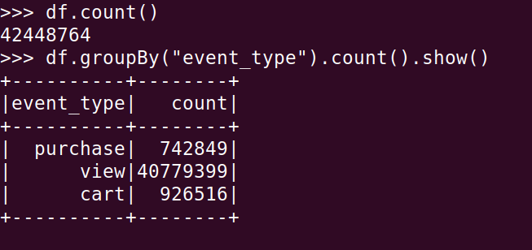
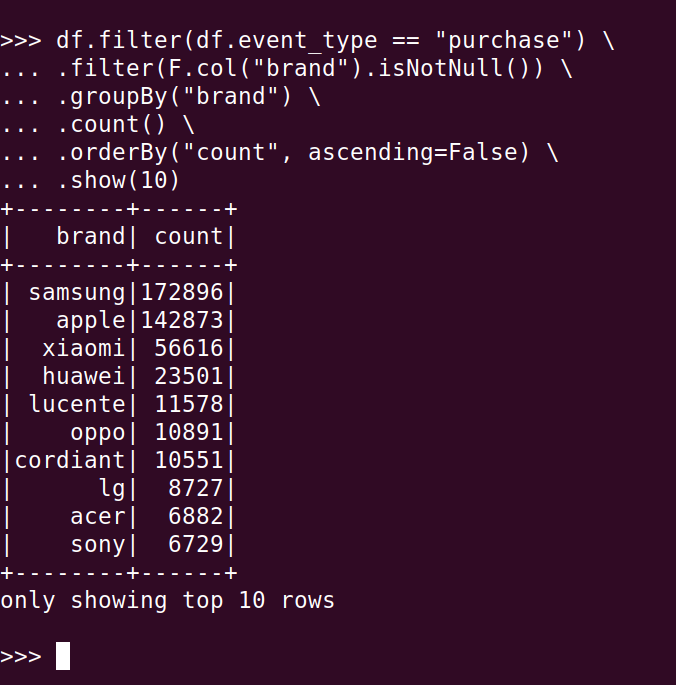
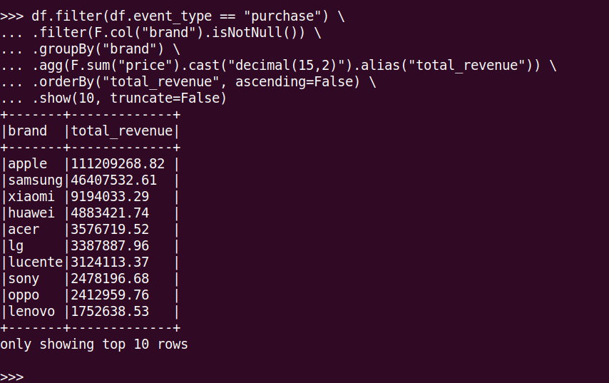
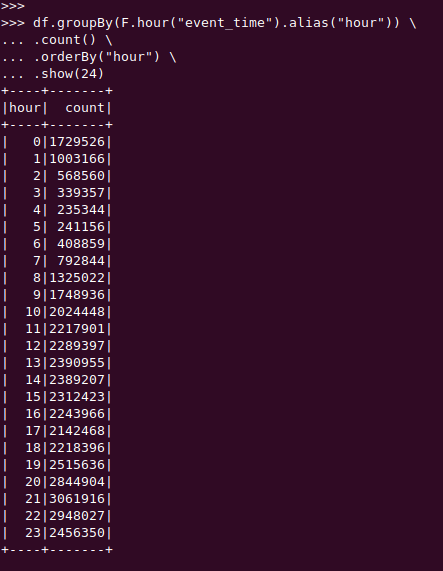
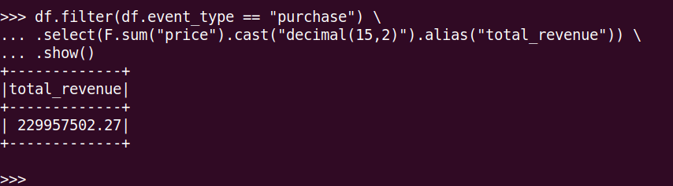
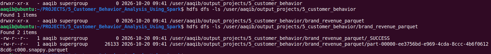
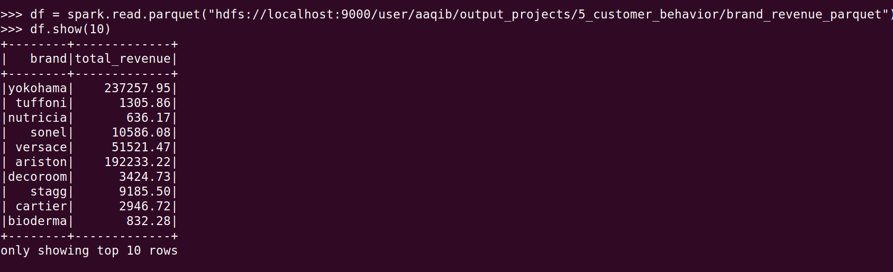
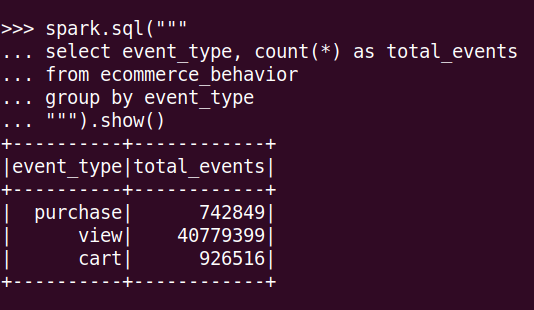
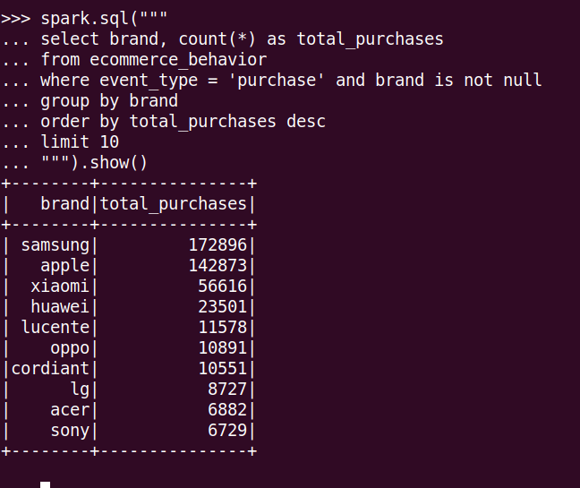
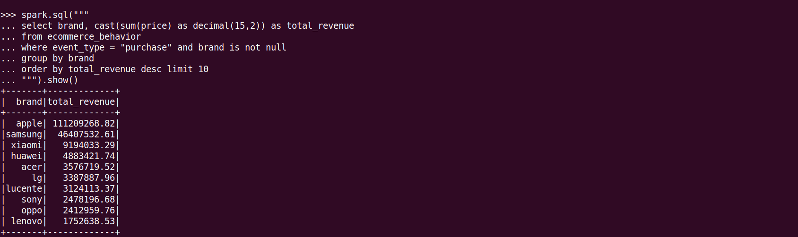

# Customer Behavior Analysis Using Apache Spark

## 1. Project Overview
This project analyzes e-commerce customer behavior data using **Apache Spark (PySpark)**. The data is stored in **Hadoop HDFS** and processed using Spark DataFrames and Spark SQL.
It examines customer events such as product views, cart additions, and purchases, and covers products, brands, categories, users, sessions, and revenue. Brand-wise purchase revenue is saved back to HDFS in **Parquet** format.

## 2. Problem Statement
E-commerce platforms generate large volumes of customer interaction events. This project uses Spark to summarize those events and identify patterns such as popular products, frequently purchased brands, customer activity over the day, and purchase revenue.

## 3. Dataset
The project uses e-commerce behavior data for **October 2019** (`2019-Oct.csv`, roughly 5 GB).

```text
data_sets/ecommerce_behavior/
└── 2019-Oct.csv
```

HDFS input path:

```text
/user/aaqib/input_projects/5_customer_behavior/
```

| Field | Description |
|---|---|
| `event_time` | Timestamp of the customer event (UTC) |
| `event_type` | Event type: `view`, `cart`, or `purchase` |
| `product_id` | Product identifier |
| `category_id` | Category identifier |
| `category_code` | Product category |
| `brand` | Product brand |
| `price` | Product price |
| `user_id` | Customer identifier |
| `user_session` | Session identifier |

## 4. Technologies Used

- Python
- Apache Spark (PySpark DataFrames)
- Spark SQL
- Hadoop HDFS
- Linux (Ubuntu)
- CSV input, Parquet output

## 5. Architecture

```text
CSV file
   |
   v
HDFS
   |
   v
PySpark application
   |
   v
Spark DataFrame
   |
   +---------------------------+
   |                           |
   v                           v
DataFrame analysis       Temporary SQL view
   |                           |
   +-------------+-------------+
                 |
                 v
          Analysis results
                 |
                 v
      Brand revenue (Parquet)
                 |
                 v
               HDFS
```

## 6. Analysis Performed

1. Count of events by event type
2. Top 10 viewed products
3. Top 10 purchased products
4. Top 10 brands by purchase count
5. Top 10 brands by revenue
6. Most active users
7. Most added-to-cart products
8. Top categories by purchase count
9. Average price by category
10. Total number of unique users
11. Most active sessions
12. Hourly activity
13. Highest-value purchases
14. Users who added to cart but have no purchase event in the loaded data
15. Total purchase revenue

## 7. Results

### Event Type Distribution


About 96% of the 42.4 million events are views, while carts (2.2%) and purchases (1.7%) are small, showing a steep funnel.

### Top Brands by Purchases


Samsung leads with 172,896 purchase events, followed by Apple and Xiaomi.

### Top Brands by Revenue


Apple generates the highest revenue (about 111.2 million) despite fewer purchases than Samsung, because of a much higher average price per purchase.

### Hourly Activity


Activity peaks at 21:00 UTC with about 3.06 million events and is lowest at 04:00 UTC with about 0.24 million events. Traffic stays steady through the midday hours and rises again in the evening (timestamps are in UTC).

### Total Revenue

The total revenue generated from all purchase events is approximately 230 million.

### Parquet Output in HDFS


The `_SUCCESS` marker and the `part-*.parquet` file confirm the result was written to HDFS.



Reading the Parquet output back with Spark shows the `brand` and `total_revenue` columns.

## 8. Spark SQL

A temporary view is created from the DataFrame:

```python
df.createOrReplaceTempView("ecommerce_behavior")
```

The same event and brand analyses are also run with `spark.sql(...)`, and the results were cross-checked against the DataFrame API versions.

The queries are collected in:

```text
queries/analysis_queries.sql
```

### SQL Output
Event Type-wise Total Events

The dataset contains the highest number of view events, followed by cart and purchase events.

Top 10 Brands by Purchase Count

Samsung has the highest number of purchase events, followed by Apple and Xiaomi.

Top 10 Brands by Total Revenue

Apple generates the highest revenue, followed by Samsung and Xiaomi.

The SQL results match the DataFrame API results.

## 9. Output

Brand-wise purchase revenue is saved in **Parquet format**:

```text
/user/aaqib/output_projects/5_customer_behavior/brand_revenue_parquet/
```

The output is a folder containing `_SUCCESS` and one or more `part-*.parquet` files. Read it back with Spark:

```python
spark.read.parquet("hdfs://localhost:9000/user/aaqib/output_projects/5_customer_behavior/brand_revenue_parquet").show()
```

## 10. Design Decisions and Data Quality

- **Null handling:** `brand` and `category_code` contain null values. Rows with null values are excluded from brand and category analyses (the null counts are printed at the start of the script).
- **Parquet output:** Parquet is columnar, compressed, and keeps the schema with the data, so it is fast to read and easy to use from BI tools or later Spark jobs.
- **Only brand revenue is persisted:** the other analyses are exploratory and displayed on the console (see Results). Brand revenue is the key business metric and is small enough to store as a reusable output.
- **Persistence:** the DataFrame is persisted with `MEMORY_AND_DISK`, so the large CSV is not re-read from HDFS for every analysis and Spark can spill to disk if memory runs short.
- **Timestamps** are in UTC.

## 11. Project Structure

```text
.
├── data_sets
│   └── ecommerce_behavior
│       └── 2019-Oct.csv
├── docs
│   ├── project_documentation.md
│   └── screenshots
│       ├── pyspark_output
│       │   ├── 01_event_distribution.png
│       │   ├── 02_top_brands_purchases.png
│       │   ├── 03_top_brands_revenue.png
│       │   ├── 04_hourly_activity.png
│       │   ├── 05_total_revenue.png
│       │   ├── 06b_parquet_read.png
│       │   └── 06_parquet_output.png
│       └── sql_output
│           ├── 01_sql_event_distribution.png
│           ├── 02_sql_top_brands_purchases.png
│           └── 03_sql_brand_revenue.png
├── output
│   └── brand_revenue_parquet
├── queries
│   └── analysis_queries.sql
├── README.md
└── spark_scripts
    └── behavior_analysis.py
```

## 12. How to Run

Run these commands from the project root directory.

**Step 1: Upload the dataset to HDFS**

```bash
hdfs dfs -mkdir -p /user/aaqib/input_projects/5_customer_behavior

hdfs dfs -put data_sets/ecommerce_behavior/2019-Oct.csv \
/user/aaqib/input_projects/5_customer_behavior/
```

If the file already exists in HDFS, check first to avoid a duplicate-file error:

```bash
hdfs dfs -ls /user/aaqib/input_projects/5_customer_behavior/
```

**Step 2: Run the PySpark application**

```bash
spark-submit --master local[2] --driver-memory 2g spark_scripts/behavior_analysis.py
```

To also save the console output to a log file:

```bash
spark-submit --master local[2] --driver-memory 2g spark_scripts/behavior_analysis.py 2>&1 | tee output_log.txt
```

**Step 3: Check the output in HDFS**

```bash
hdfs dfs -ls /user/aaqib/output_projects/5_customer_behavior/brand_revenue_parquet/
```

## 13. Key Learning Outcomes

- Working with a large e-commerce dataset using PySpark
- Reading CSV data from HDFS
- DataFrame filtering, grouping, aggregation, and sorting
- Using Spark SQL with a temporary view
- Handling null values in analysis
- Customer, product, brand, category, session, and revenue analysis
- Writing aggregated results to HDFS in Parquet format

## 14. Conclusion

This project demonstrates an e-commerce analytics workflow using PySpark and HDFS. It applies DataFrame and Spark SQL transformations to customer interaction data and writes brand-wise purchase revenue to Parquet files in HDFS.
